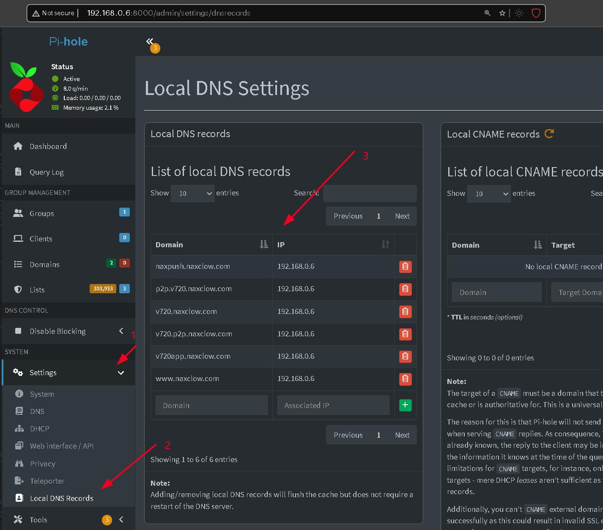

# Raspberry Pi Naxclow Server Setup Guide

The setup involves the following:

1. [Setup local DNS server](#1-setup-local-dns-server)
2. [Add local DNS entries](#2-add-local-dns-entries)
3. [Install MQTT broker](#3-install-mqtt-broker)
4. [Get and setup this x5 server](#4-get-and-setup-this-x5-server)
5. [Setup camera](#5-setup-camera)
6. [Camera commands](#6-camera-commands)
7. [Viewing video and audio](#7-viewing-video-and-audio)
8. [Run the server at startup](#8-run-the-server-at-startup)
9. [Useful commands](#9-useful-commands)

Following is the overall architecture that we are going setup:

```text
                          Raspberry Pi
                           192.168.x.x
                                │
          ┌─────────────────────┴─────────────────────┐
          │                                           │
Mosquitto MQTT broker                        x5-v720 python server
      TCP 1883                                     HTTP :80
          │                                           │
          │                                           │
          │                                           │
          │                                           │
          │                                           │
          │                                           │
          │                                           │
          │                                           │
          │                                       Web Browser
          └──────────────┐                     ┌──────┴──────┐
                         │                     │             │
                    x5 Camera                /live       /irOn
                  192.168.x.x                /audio      /irOff
                  ID 080c00049CA2            /snapshot
```

Live video flow:

```text
x5 Camera
     │
     │ UDP packets
     ▼
x5 server on Raspberry Pi
     │
     │ HTTP MJPEG frames
     ▼
Web Browser on Mobile phone
```

HTTP URL command flow:

```text
HTTP http://192.168.x.x/dev/080c00049CA2/irOn
     │
     ▼
x5-server on Raspberry Pi
     │
     ▼
mosquitto_pub command
     │
     ▼
Mosquitto :1883 MQTT broker
     │
     ▼
x5 Camera
     │
     ▼
  IR mode on
```

---

## 1. Setup local DNS server

We need a local DNS server to tell the camera that all the `*.naxclow.com` domain names point to the local Raspberry Pi device. If your router support adding local DNS entries then use it. Otherwise you need to setup a DNS server like Dnsmasq, Unbound, Bind, etc. I chose Pi-hole because it also allows blocking malicious and advertisement domains.\
Setup Pi-hole on the Raspberry Pi using the following video. Use wired network connection on the Raspberry PI to avoid lags in video streams. Do not use WiFi connection.

[](https://www.youtube.com/watch?v=Z_sVjxu9LjE)

Make sure to assign static IP to the Raspberry Pi machine so that the IP remains the same across power cycles. It is best to set it on router but you can also do it [using `sudo nmtui` command](https://www.youtube.com/watch?v=qy1_jV1fgJU) on Raspberry Pi.

Make sure to modify your router setting to use Raspberry Pi's IP address as DNS provider in LAN settings. Instead of using the usual `1.1.1.1` or `8.8.8.8` use only the Raspberry Pi's IP address, like `192.168.0.6`. You have to set the DNS IP on the router because the camera directly queries router. The `192.168.0.6` is my Raspberry Pi machine IP address. I'll use it throughout the demo.

We are going to host the x5 python server on the same Raspberry Pi machine where we've setup Pi-hole. By default Pi-hole admin console uses port 80. But we need the 80 port for our x5 server. To change the Pi-hole console port edit `pihole.toml` configuration file:

```bash
sudo nano /etc/pihole/pihole.toml
```

Change the following line

```text
port = "80o,443os,[::]:80o,[::]:443os"
to
port = "8000o,443os,[::]:8000o,[::]:443os"
```

Restart Pi-hole server using

```bash
sudo pihole restartdns
```

Now the Pi-hole admin console should open on http://192.168.0.6:8000/admin/.

Make sure the port 80 is free. Run the following and it should return nothing:

```bash
sudo ss -ltnp | grep ':80 '
```

## 2. Add local DNS entries

Map all the following domains to the x5 server IP address. In this case we are hosting everything on the Raspberry Pi so the x5 server IP would be `192.168.0.6`.

```text
www.naxclow.com
v720.naxclow.com
p2p.v720.naxclow.com
v720.p2p.naxclow.com
naxpush.naxclow.com
v720app.naxclow.com
```

You can easily do it using Pi-hole admin console:



Above domain names will do but if you want to know if the camera is trying to connect to other web servers then monitor Pi-hole logs http://192.168.0.6:8000/admin/queries with `Live updates` setting on. Then power on the camera after it is connected in WiFi network.

## 3. Install MQTT broker

To install the MQTT broker run following commands in a terminal on the Raspberry Pi:

```bash
sudo apt update
sudo apt install mosquitto mosquitto-clients
sudo systemctl enable mosquitto
sudo systemctl start mosquitto
sudo systemctl status mosquitto
```

To test the MQTT broker open new terminal and run the following. We'll use this command to get details from the camera in the future.

```bash
mosquitto_sub -h 127.0.0.1 -t '#' -v
```

Open one more terminal and run the following:

```bash
mosquitto_pub -h 127.0.0.1 -t test -m "hello"
```

The first terminal should show:

```text
test hello
```

Initially Mosquitto may listen only on `127.0.0.1:1883`. That does NOT allow the external devices like the x5 camera to connect it. The camera needs to connect it on the IP address `192.168.0.6:1883`. Create the listener configuration:

```bash
sudo nano /etc/mosquitto/conf.d/x5-v720.conf
```

Add the following text and save the file.

```text
listener 1883 0.0.0.0
allow_anonymous true
```

Restart Mosquitto:

```bash
sudo systemctl restart mosquitto

# Check that MQTT is listening:
sudo ss -ltnp | grep 1883
```

You should see port 1883 listening on the LAN interface / all interfaces.

## 4. Get and setup this x5 server

Clone this repository using the following commands on Raspberry Pi:

```bash
cd ~
mkdir github
cd github/
git clone https://github.com/OnkarRuikar/x5-v720.git
cd x5-v720/
```

Latest Raspberry Pi installations come with Python version 3.13. We need Python 3.11. First check whether your Pi already has it:

```bash
python3.11 --version
```

If you get something like:

```bash
Python 3.11.x
```

then you're ready. Otherwise need to setup v3.11 in the `~/github/x5-v720` folder. Use following commands:

```bash
sudo apt install -y \
    build-essential \
    curl \
    git \
    libssl-dev \
    zlib1g-dev \
    libbz2-dev \
    libreadline-dev \
    libsqlite3-dev \
    libncursesw5-dev \
    xz-utils \
    tk-dev \
    libxml2-dev \
    libxmlsec1-dev \
    libffi-dev \
    liblzma-dev \
    libgdbm-dev \
    libnss3-dev

curl https://pyenv.run | bash

# add pyenv to your shell
echo 'export PATH="$HOME/.pyenv/bin:$PATH"' >> ~/.bashrc
echo 'eval "$(pyenv init -)"' >> ~/.bashrc
source ~/.bashrc
pyenv --version

# install Python 3.11
pyenv install 3.11.9
pyenv versions
```

After we have the right Python version in place lets create the Python virtual environment:

```bash
cd ~/github/x5-v720
# remove old env in case something went wrong earlier
rm -rf .venv
pyenv local 3.11.9
python --version

# create environment
python -m venv .venv
# activate it
source .venv/bin/activate

# verify again
python --version
which python
```

Upgrade the Python packaging tools:

```bash
python -m pip install --upgrade pip setuptools wheel
```

Install the project requirements:

```bash
python -m pip install -r requirements.txt
```

Verify Python:

```bash
.venv/bin/python --version
```

If you've installed lite version of `Raspberry Pi OS/Debian Lite` then you don't have the desktop and the system doesn't have the OpenGL library installed. Install the missing library using the following:

```bash
sudo apt update
sudo apt install -y libgl1

# verify
source .venv/bin/activate
python -c "import cv2; print(cv2.__version__)"
```

Start the local x5 server:

```bash
cd ~/github/x5-v720
sudo .venv/bin/python src/a9_naxclow.py -s
```

You'll see output like:

```text
-------- x5 V720 fake-server starting. --------
Device list: http://127.0.0.1:80/dev/list
Live capture: http://127.0.0.1:80/dev/[CAM-ID]/live
Audio capture: http://127.0.0.1:80/dev/[CAM-ID]/audio
Snapshot: http://127.0.0.1:80/dev/[CAM-ID]/snapshot
IR On: http://127.0.0.1:80/dev/[CAM-ID]/irOn
IR Off: http://127.0.0.1:80/dev/[CAM-ID]/irOff
```

You can access these URLs from other devices using IP address of the Raspberry Pi. For example, `http://192.168.0.6/dev/[CAM-ID]/live`.

If you want to see more information and debug then start the server in verbose mode:

```bash
sudo .venv/bin/python src/a9_naxclow.py -sv
```

## 5. Setup camera

First we need to monitor MQTT logs to get the camera details when it connects to your WiFi. Run the following in a separate terminal:

```bash
mosquitto_sub -h 127.0.0.1 -t '#' -v
```

We need to set WiFi name and password on the camera so that it can work in local network. Unfortunately, for the first time it can only be done through the v720 app. I think the app uses Bluetooth to configure WiFi on the camera. Refer [this YouTube video](https://www.youtube.com/watch?v=QLVqyQOp9FI) to set the WiFi credentials for the first time.

Once the camera is in your WiFi network, within few seconds it'll connect to the x5 server and you'll see logs like the following in x5 server terminal:

```text
-------- Found device 080c00049CA2 --------
Live capture: http://127.0.0.1:80/dev/080c00049CA2/live
Only audio capture: http://127.0.0.1:80/dev/080c00049CA2/audio
Only video capture: http://127.0.0.1:80/dev/080c00049CA2/video
Snapshot: http://127.0.0.1:80/dev/080c00049CA2/snapshot
IR On: http://127.0.0.1:80/dev/080c00049CA2/irOn
IR Off: http://127.0.0.1:80/dev/080c00049CA2/irOff
```

And in the MQTT logs:

```text
Naxclow/P2P/Users/Device/Status {"device":"080c00049CA2","token":"NAXCLOW","status": 0}
Naxclow/P2P/Users/Device/Status {"device":"080c00049CA2","token":"NAXCLOW","status": 1}
Naxclow/P2P/Users/Device/Info {"apStatus": 0,"devPower": 100,"sdCapacity": 0,"IrLed": 0,"instLed": 1,"sdMoveMode": 0,"sdCardReco": 1,"moveGrade": 0,"pirAlert": 0,"pirGrade": 2,"cameraState": 0,"random":"HIJKLM","token":"21521bf380","devicesCode":"080c00049CA2","wifiName":"MyWiFi","version":"202406171854"}
```

## 6. Camera commands

Here are a few commands we can send to camera using MQTT broker or the x5 HTTP server. MQTT commands are to be run from Raspberry Pi terminal. HTTP URLs can be invoked from any web browser in the network.

Turn infrared mode on using MQTT:

```bash
mosquitto_pub \
  -h 127.0.0.1 \
  -t 'Naxclow/P2P/Users/Device/sub/080c00049CA2' \
  -m '{"code":202,"IrLed":1}'
```

Turn off:

```bash
mosquitto_pub \
  -h 127.0.0.1 \
  -t 'Naxclow/P2P/Users/Device/sub/080c00049CA2' \
  -m '{"code":202,"IrLed":0}'
```

You can achieve the same using HTTP URLs from any web browser in the network:

```text
http://192.168.0.6/dev/080c00049CA2/irOn
http://192.168.0.6/dev/080c00049CA2/irOff
```

In future, if you whish to change WiFi name/password or move camera to different network, then run following *before* changing settings on router:

```bash
mosquitto_pub \
  -h 127.0.0.1 \
  -t 'Naxclow/P2P/Users/Device/sub/080c00049CA2' \
  -m '{"code":204,"wifiName": "MyNewWifi","password": "44332211"}'
```

If you've already changed WiFi then above MQTT command is not useful; you need to use the v720 app to update the WiFi information.

To disable PIR alerts use the following MQTT command:

```bash
mosquitto_pub \
  -h 127.0.0.1 \
  -t 'Naxclow/P2P/Users/Device/sub/080c00049CA2' \
  -m '{"code":213,"pirAlert": 0}'
```

## 7. Viewing video and audio

To use the camera from a web browser use following URLs from any device in your LAN.

Take a snapshot:

```txt
http://192.168.0.6/dev/080c00049CA2/snapshot
```

View live video:

```txt
http://192.168.0.6/dev/080c00049CA2/live
```

Play live audio:

```txt
http://192.168.0.6/dev/080c00049CA2/audio
```

The mic on the camera is very weak. I am using a separate ESP32 I2C mic to stream clear audio.

For easy viewing, edit [x5stream.html](../x5stream.html) and update URLs. Then  copy the `x5stream.html` file on your computer or mobile phone and simply open it in any browser.

> 

## 8. Run the server at startup

Till now we've run the x5 server manually. Now we want to start the server automatically every time when the Raspberry Pi is powered on. First we'll create a service and then make it run automatically.

Create a service file:

```bash
sudo nano /etc/systemd/system/x5-v720.service
```

Then paste the following. Don't forget to update user's home directory in the text below.

```ini
[Unit]
Description=x5 V720 Naxclow Server
After=network-online.target mosquitto.service
Wants=network-online.target
Requires=mosquitto.service

[Service]
Type=simple
User=root
WorkingDirectory=/home/onk/github/x5-v720
ExecStart=/home/onk/github/x5-v720/.venv/bin/python /home/onk/github/x5-v720/src/a9_naxclow.py -s

Restart=always
RestartSec=5

Environment=PYTHONUNBUFFERED=1

[Install]
WantedBy=multi-user.target
```

The user has to be `root` because the HTTP server uses the privileged port `80`.

After saving the file reload systemd:

```bash
sudo systemctl daemon-reload
```

Now to enable automatic startup

```bash
sudo systemctl enable x5-v720.service
```

Start and check the Server

```bash
sudo systemctl start x5-v720.service
sudo systemctl status x5-v720.service
```

Look for the following in the output:

```text
Active: active (running)
```

To see whats going on you'll need to check the logs in future. Use following command to see the logs:

```bash
sudo journalctl -u x5-v720.service -f
```

To view logs from the current boot:

```bash
sudo journalctl -u x5-v720.service -b
```

---

## 9. Useful commands

Check if the x5 server is running on port '80'

```bash
sudo ss -ltnp | grep ':80 '
```

Output should look like:

```text
LISTEN 0      5            0.0.0.0:80        0.0.0.0:*    users:(("python",pid=108858,fd=3))
```

Commands for x5 server service:

```bash
sudo systemctl status X5-v720.service
sudo systemctl start x5-v720.service
sudo systemctl stop x5-v720.service
sudo systemctl restart x5-v720.service
```

To follow the server logs:

```bash
sudo journalctl -u x5-v720.service -f
```

To see current boot logs:

```bash
sudo journalctl -u x5-v720.service -b
```

Disable automatic x5 server startup

```bash
sudo systemctl disable x5-v720.service
```

Check MQTT broker port

```bash
sudo ss -ltnp | grep 1883
```

Check Mosquitto

```bash
sudo systemctl status mosquitto
```

Restart Mosquitto

```bash
sudo systemctl restart mosquitto
```

Do look at https://github.com/intx82/a9-v720 for in depth information.
