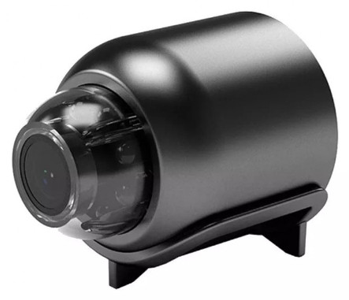
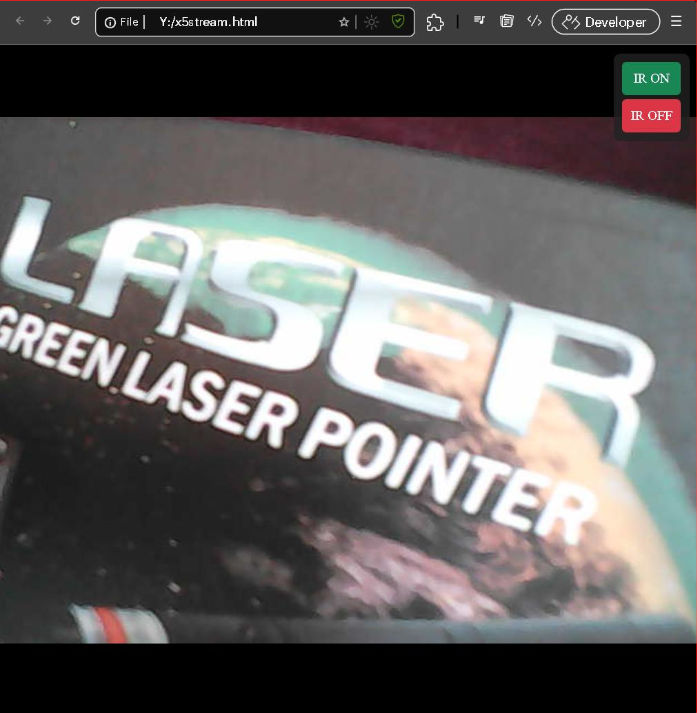

# X5 V720 Naxclow Local Server

> 

The X5 V720 is a low price small camera. But it sends all the data and video streams to `*.naxclow.com`. To protect privacy the we need to setup a local Naxclow like server to use the camera. With this server we can use the camera in any web browser, and we won't need the v720 mobile App. Also the data won't leave local network. 

**Note:** The implementation has been done on top of the existing https://github.com/intx82/a9-v720 repository, which implements the server for A9 V720 camera. For in-depth details refer the a9-v720 repository.

The x5 sever exposes following HTTP URLs to use/access the camera:

http://192.168.0.6/dev/080c00049CA2/live - video stream\
http://192.168.0.6/dev/080c00049CA2/audio - audio stream\
http://192.168.0.6/dev/080c00049CA2/snapshot - single photo capture\
http://192.168.0.6/dev/080c00049CA2/irOn - turn on infrared mode. Black and white video.\
http://192.168.0.6/dev/080c00049CA2/irOff - turn on color mode. Colorful video.\
http://192.168.0.6/dev/list - list all V720 type cameras connected to the server.

Here `192.168.0.6` is the local Naxclow (Raspberry Pi) server IP. And `080c00049CA2` is the camera identifier. 

Edit the [x5stream.html](x5stream.html) file to update URLs and open the file in any browser to see the video stream:

> 

## Hardware

I've used the following hardware. If you have some experience with linux, then you can try other devices.

|Device|Description|
|----|----|
|X5 V720 camera| They advertise it as 2MP camera, but it is only a 0.3 megapixel (640 x 480) camera. Version `202406171854`. The cam consumes 5V ~200mA power. |
|[Raspberry Pi 4 Model B](https://www.raspberrypi.com/products/raspberry-pi-4-model-b/)| Required to host [Pi-hole](https://pi-hole.net/), MQTT broker, and this x5 server. I think any machine that can host Pi-hole will do, i.e. any linux SBC or PC machine. |
|Power supply for camera| Any 5 volt >0.5Amp phone charger. Or power bank.|

If you have time and resource then you can try the server on other V720 app supported cameras as well, like A9 camera.

## Setup

Refer the [Raspberry Pi Naxclow Server Setup Guide](docs/entire_setup.md) page. I've dumped everything on the single page because everything is going to happen on Raspberry Pi.

## Camera internals

Photos of internals of the camera are on the [Camera internals](docs/camPhotos.md) page.